# صَرْح | SARH ERP — دليل رحلة المستخدم وخارطة طريق العمليات

## (From Tenant Signup to Cost Baseline — Complete Architectural & Business Journey)

> **وثيقة معتمدة وموجهة لفرق العمل وإدارة النظام**  
> **العلامة التجارية:** نظام صَرْح لإدارة المقاولات والتشطيبات الذكية (SARH ERP)  
> **الهوية اللونية:** الزمردي الرقمي (`#00C896`) | الكحلي الداكن الفاخر (`#0C1315` / `#0F172A`)  
> **الخط المعتمد:** خط Cairo الهندسي العربي  
> **نطاق المرحلة:** يغطي الرحلة التشغيلية المتكاملة من لحظة التسجيل وحتى نهاية **المرحلة العاشرة (Phase 10 — Estimation)**

---

## 🏛️ 1. فلسفة صرح (The SARH Philosophy)

نظام **صَرْح (SARH ERP)** ليس مجرد أداة لإدخال البيانات، بل هو **محرك حوكمة هندسي ومالي صارم** مُصمم خصيصاً لشركات المقاولات والتشطيبات والديكور والمكاتب الهندسية.

يقوم النظام على **مبدأ الحقيقة المتسلسلة غير القابلة للكسر (Single Chain of Truth)**:

> **لا يُسمح بتخمين كمية، ولا يُسمح بخلط التكلفة بسعر البيع، ولا يُسمح بتعديل وثيقة تم اعتمادها تاريخياً.** كل خطوة تسلم للخطوة التالية ببيانات مجمدة ومعتمدة عبر تسلسل تدقيق رقمي (`Audit Trail`).

---

## 🧭 2. المخطط الشامل لرحلة المهندس "أحمد" (Workflow Architecture)

```mermaid
flowchart TD
    %% Styling
    classDef startClass fill:#00C896,stroke:#00A87E,stroke-width:2px,color:#fff;
    classDef stepClass fill:#0F172A,stroke:#00C896,stroke-width:1.5px,color:#fff;
    classDef decisionClass fill:#1E293B,stroke:#38BDF8,stroke-width:1.5px,color:#F8FAFC;
    classDef endClass fill:#059669,stroke:#10B981,stroke-width:2px,color:#fff;

    Start([1. تسجيل حساب جديد - م. أحمد]):::startClass --> Provision[تأسيس قاعدة بيانات الشركة المعزولة تلقائياً]:::stepClass
    Provision --> TeamChoice{هل سيعمل بمفرده أم مع فريق؟}:::decisionClass

    TeamChoice -- دعوة الفريق --> TeamRoles[إضافة المهندسين وتوزيع الصلاحيات RBAC]:::stepClass
    TeamChoice -- العمل منفرداً --> LeadChoice:::decisionClass
    TeamRoles --> LeadChoice{مصدر المشروع الجديد؟}:::decisionClass

    LeadChoice -- عميل محتمل مؤقت --> LeadFlow[تسجيل Lead ومتابعته حتى التأهيل]:::stepClass
    LeadChoice -- عميل مباشر --> OppFlow[تسجيل العميل وفتح فرصة تجارية Opportunity]:::stepClass
    LeadFlow --> OppFlow

    OppFlow --> SiteVisitDecision{هل يحتاج المشروع معاينة ميدانية؟}:::decisionClass

    SiteVisitDecision -- نعم: موقع قائم --> SiteVisitFlow[جدولة وتنفيذ المعاينة الميدانية ورفع الصور]:::stepClass
    SiteVisitDecision -- لا: مخططات جاهزة --> MeasureChoice:::decisionClass
    SiteVisitFlow --> MeasureChoice{طريقة إعداد الرفع والمقايسة؟}:::decisionClass

    MeasureChoice -- الخيار الذكي السريع --> DxfFlow[رفع مخطط أوتوكاد DXF واستخراج الفراغات آلياً]:::stepClass
    MeasureChoice -- الخيار الميداني اليدوي --> ManualFlow[إدخال الغرف والأبعاد والخصومات يدوياً]:::stepClass

    DxfFlow --> MeasureApprove[مراجعة واعتماد المقايسة - Approved]:::stepClass
    ManualFlow --> MeasureApprove

    MeasureApprove --> ScopeFlow[إعداد نطاق الأعمال والمواصفات SOW وربطه بالقياسات]:::stepClass
    ScopeFlow --> ScopeApprove[اعتماد نطاق الأعمال والمشتملات والاستثناءات - Approved]:::stepClass

    ScopeApprove --> BoqGen[توليد جدول الكميات BOQ آلياً بضغطة زر مع تجميد الكميات]:::stepClass
    BoqGen --> BoqApprove[اعتماد جدول الكميات الفني - Approved]:::stepClass

    BoqApprove --> EstFlow[إنشاء دراسة التكاليف والأسعار الداخلية Cost Estimation]:::stepClass
    EstFlow --> Breakdown[تفكيك التكلفة: مواد + عمالة + معدات + مقاول باطن + أخرى]:::stepClass
    Breakdown --> Overhead[تحديد نسبة المصاريف الإدارية والهامش غير المباشر Overhead %]:::stepClass

    Overhead --> ZeroCostCheck{هل توجد بنود مجانية أو بتكلفة صفر؟}:::decisionClass
    ZeroCostCheck -- نعم --> ZeroCostJustify[إلزام باختيار مبرر معتمد أو كتابة سبب موثق >= 10 أحرف]:::stepClass
    ZeroCostCheck -- لا --> FinalApproval[تقديم للاعتماد الإداري والمالي]:::stepClass
    ZeroCostJustify --> FinalApproval

    FinalApproval --> BaselineLocked([اكتمال خط التكلفة المعتمد وحمايته بالقفل الحصري]):::endClass
```



---

## 📍 3. المحطات التفصيلية والقرارات والمسارات المتاحة لـ "أحمد"

---

### المحطة 1: تأسيس الشركة وبيئة العمل (Tenant Provisioning & Onboarding)

- **المشهد:** يدخل المهندس أحمد على رابط المنصة ويسجل شركته: _"شركة الأفق للمقاولات والديكور"_.
- **ماذا يحدث في صلب النظام (Architecture Engine)؟**
    1. يقوم معالج التأسيس (`TenantProvisioningService`) بإنشاء **قاعدة بيانات مستقلة ومعزولة تماماً** للشركة (مثال: `sarh_tenant_alofoq`).
    2. يتم تشغيل هجرات الجداول الخاصة بالمستأجر، وضبط عزل الصلاحيات، وإنشاء المستخدم الأساسي لأحمد برتبة **المالك (`Owner`)**.
    3. يتم تفعيل نطاق فرعي خاص بالشركة لتأمين العزل الكامل للبيانات (`Multi-Tenancy`).

- **القرارات والمسارات المتاحة لأحمد:**
    - **المسار (1-أ): استدعاء وتفويض الفريق (Team Onboarding):**
        - يدخل أحمد على لوحة إدارة المستخدمين ويدعو فريقه:
            - **مهندس الموقع:** يُمنح صلاحيات المعاينات والمقايسات (`measurements.create`).
            - **مقدر التكاليف (Quantity Surveyor):** يُمنح صلاحيات إعداد دراسات التكلفة والـ BOQ (`estimations.create`, `boqs.create`).
            - **مدير المشاريع:** يُمنح صلاحية الاعتماد (`estimations.approve`).
    - **المسار (1-ب): الانطلاق الفردي المباشر:**
        - إذا كانت شركة أحمد ناشئة ويديرها بنفسه، ينطلق مباشرة بحسابه كـ `Owner` الذي يمتلك كافة الصلاحيات بدون أي حواجز.

---

### المحطة 2: إدارة العملاء والفرص التجارية (Customers & Opportunities)

- **المشهد:** تواصلت _"شركة المدار للاستثمار"_ مع أحمد لطلب تشطيب مقر إداري فاخر بالرياض بمساحة 800 م².
- **ماذا يفعل أحمد؟**
    - **المسار (2-أ) — مسار العميل المحتمل (Lead Management):**
        - إذا كان العميل مجرد استفسار أولي غير مؤكد، يسجله أحمد كـ **Lead**.
        - يتابع فريقه حالة الاستفسار (اتصال، تواصل واتساب، إبداء رغبة).
        - فور التأكد من الجدية، يضغط على **تحويل إلى عميل (Convert to Customer)**.
    - **المسار (2-ب) — مسار العميل المباشر:**
        - يسجل أحمد العميل فوراً في سجل العملاء (اسم الشركة، الرقم الضريبي، جهة الاتصال، العنوان).
        - ينشئ **فرصة تجارية (Opportunity)** باسم: _"مشروع تشطيب مقر شركة المدار"_.

- **قرار المسار التالي:**
    - ❓ **هل المبنى قائم على الطبيعة ويحتاج فحصاً ورفعاً؟** ⬅️ الانتقال إلى **المحطة 3 (المعاينة الميدانية)**.
    - ❓ **هل سلّم العميل مخططات أوتوكاد معمارية نهائية وجاهزة؟** ⬅️ القفز مباشرة إلى **المحطة 4 (المقايسة)**.

---

### المحطة 3: المعاينة الميدانية التوثيقية (Site Visits)

- **المشهد:** يحدد أحمد موعداً لمعاينة الموقع في برج العليا، ويكلف مهندس الموقع بالزيارة.
- **إجراءات مهندس الموقع:**
    - يفتح النظام من الجوال أو التابلت في الموقع.
    - يوثق حالة الموقع الحالية: _حالة تمديدات الكهرباء، مخارج التكييف، أماكن الرطوبة، سهولة دخول المعدات ونقل المخلفات_.
    - يلتقط الصور الحية ويرفعها مباشرة في قسم المرفقات (`Media Library`).
- **الخيارات المتاحة:**
    - **اكتمال الزيارة (Completed):** حفظ التقرير الفني الميداني، ويتحول المشروع تلقائياً لمرحلة الرفع الفعلي.
    - **إعادة الجدولة (Rescheduled):** إذا تعذر دخول الموقع لأسباب أمنية أو تصاريح.

---

### المحطة 4: الرفع الهندسي والمقايسة الرقمية (Measurements & CAD Engine)

- **الهدف:** تفريغ الواقع أو المخطط إلى أبعاد هندسية حقيقية وحساب صافي الكميات (مساحات، حجوم، أطوال، وأعداد).
- **أمام أحمد طريقتان للعمل:**

| المسار الذكي السريع (CAD DXF Upload) ⚡                                                                                                                                                                                          | المسار الميداني اليدوي (Manual Measurements) 📐                                                                                                                                                                                                                             |
| :------------------------------------------------------------------------------------------------------------------------------------------------------------------------------------------------------------------------------- | :-------------------------------------------------------------------------------------------------------------------------------------------------------------------------------------------------------------------------------------------------------------------------- |
| • يرفع أحمد ملف الأوتوكاد بصيغة `.dxf`.<br>• محرك صرح الذكي (`DxfParserService`) يحلل الطبقات والخطوط المغلقة آلياً.<br>• يستخرج أسماء الغرف، والمحيط، والمساحات بدقة متناهية دون تدخل بشري.<br>• يوفر 90% من وقت الحساب اليدوي. | • يدخل المهندس الغرف فراغاً فراغاً: _غرفة الإدارة، قاعة الاجتماعات، المكاتب المفتوحة_.<br>• يدخل الأبعاد: (طول × عرض × ارتفاع).<br>• يحدد نوع الحساب: مسطح ($م^2$)، مكعب ($م^3$)، طولي ($م.ط$)، أو عدد ($قطعة$).<br>• يدرج الخصومات الهندسية (مثل فتحات الأبواب والشبابيك). |

- **حوكمة الاعتماد والتجميد (Immutability):**
    - يقوم المهندس المسؤول بمراجعة المقايسة، ثم تقديمها للاعتماد (`Submit for Review`).
    - بعد الاعتماد تصبح المقايسة **وثيقة مقفلة ومحمية (Approved)**.
- **ماذا لو غيّر العميل تصميمه بعد الاعتماد؟**
    - 🛑 **قاعدة صرح الحديدية:** لا تعديل في السجلات المعتمدة السابقة مطلقاً.
    - ✅ **الحل:** يضغط أحمد على **إنشاء إصدار جديد (Create Revision)**، فيتولد الإصدار الثاني (`V2`)، ويتحول الإصدار القديم إلى مرجع تاريخي للأرشيف.

---

### المحطة 5: نطاق الأعمال والمواصفات (Scope of Work — SOW)

- **الهدف:** تحويل الأبعاد الصامتة إلى **بنود تنفيذية بمواصفات معمارية واضحة ومسؤوليات محددة**.
- **ماذا يفعل أحمد ومكتبه الفني؟**
    1. **تصنيف الأعمال حسب التخصصات (`Trade Categories`):**
        - _أعمال الدهانات والديكور_
        - _أعمال الأرضيات والبورسلين_
        - _أعمال الأسقف المعلقة والجبس بورد_
        - _الأعمال الكهربائية والإنارة_
        - _أعمال النجارة والواجهات الزجاجية_
    2. **ربط البند بغرفه:** ربط كل بند بنطاق المقايسة المعتمدة المقابلة له.
    3. **التوصيف الفني الدقيق (`Specification`):** ذكر نوع المواد، درجات الجودة، طبقات البرايمر، نوع المعجون وسماكة السيراميك.
    4. **صمام الأمان التعاقدي — المشتملات والاستثناءات:**
        - **ما يشمله البند (`Inclusions`):** توريد السيراميك، خلط المونة، الفواصل الاستيل، العزل.
        - **ما يستثنيه البند صراحة (`Exclusions`):** أعمال تمديدات التغذية الرئيسية، أي جلي وتلميع خارج نطاق الصالة.
- **الاعتماد:** يتم اعتماد الـ Scope رسمياً ليصبح العقد الفني المرجعي.

---

### المحطة 6: جدول الكميات الفني المؤتمت (Bill of Quantities — BOQ)

- **الابتكار التقني في صرح:**
    - في الأنظمة التقليدية، يُعاد كتابة الكميات في جدول إكسل مما يسبب أخطاء كارثية وسهو في الحسابات.
    - في **صَرْح**: أحمد يضغط زر **"توليد جدول الكميات من الـ Scope"** (`Generate BOQ from Scope`).
- **ماذا يضمن النظام لأحمد؟**
    - سحب جميع البنود وتجميع كمياتها رياضياً وتجميدها.
    - **كميات ووحدات غير قابلة للتلاعب اليدوي (`Frozen Quantities & Units`)**.
    - جدول الـ BOQ يظل فنياً خالصاً **بدون أي أسعار أو هوامش ربح** لضمان فصل الشق الفني عن المالي.
- **الاعتماد:** اعتماد الـ BOQ ونقله لمرحلة التسعير.

---

### المحطة 7: دراسة التكاليف والأسعار الداخلية (Cost Estimation — قلب المرحلة 10)

هنا نصل إلى **المحطة الأهم**، حيث يتم حساب التكلفة الحقيقية (المباشرة وغير المباشرة) للمشروع لحماية أرباح الشركة.

#### 1. إنشاء دراسة التسعير:

- يولد مقدر التكاليف دراسة تسعيرية مرتبطة بالـ BOQ المعتمد.
- تُسحب البنود بكمياتها الهندسية المعتمدة رسمياً.

#### 2. تفكيك سعر التكلفة المباشرة للبند (Unit Cost Breakdown):

يقوم مقدر التكاليف بتوزيع تكلفة الوحدة الواحدة لكل بند على 5 روافد:

```text
┌────────────────────────────────────────────────────────────────────────┐
│                        تفكيك سعر الوحدة (Unit Rate)                     │
├──────────────┬──────────────┬──────────────┬──────────────┬────────────┤
│ 1. المواد    │ 2. العمالة   │ 3. المعدات   │ 4. مقاول باطن│ 5. مصاريف  │
│  (Material)  │   (Labor)    │ (Equipment)  │ (Subcontract)│   (Other)  │
├──────────────┼──────────────┼──────────────┼──────────────┼────────────┤
│  55.00 ر.س   │  25.00 ر.س   │   5.00 ر.س   │   0.00 ر.س   │  2.00 ر.س  │
└──────────────┴──────────────┴──────────────┴──────────────┴────────────┘
        │
        └─────► إجمالي التكلفة المباشرة للبند = 87.00 ريال / م²
```

#### 3. المصاريف غير المباشرة والهوالك (Overhead Rate):

- يحدد أحمد نسبة مئوية للمصاريف الإدارية والتشغيلية والهوالك العامة (مثلاً: `12%`).
- يقوم محرك الحسابات الرياضي في السيرفر بحساب الإجماليات لكل بند وللمشروع ككل فوراً.

#### 4. حوكمة البنود المجانية أو الصفرية (Zero-Cost Governance):

- ❓ **ماذا لو كانت تكلفة أحد البنود صفرية (0.00 ريال)؟** (مثال: العميل هو من يشتري البورسلين على حسابه).
- 🛑 **منع الاعتماد الأعمى:** يرفض النظام اعتماد الدراسة ذات التكلفة الصفرية ما لم يختر أحمد **أحد المبررات النظامية المعتمدة التالية**:
    1. **مواد موردة من العميل (`Client-Supplied Material`):** المالك يتكفل بالتوريد.
    2. **محملة على بند آخر (`Included in Another Item`):** تكلفتها مدمجة في بند رئيسي آخر.
    3. **في انتظار تسعيرة مورد خاص (`Pending Vendor Quote`):** بانتظار عروض أسعار تنافسية.
    4. **أخرى مع ذكر المبرر (`Other — see notes`):** بشرط كتابة مبرر إداري صريح لا يقل عن **10 أحرف**، ويتم حفظ المبرر في السجل دائماً.

#### 5. الحماية التزامنية والاعتماد الحصري (Opportunity-Level Serialization):

- عند ضغط زر **الاعتماد (Approve)**:
    - يقوم النظام بقفل سجل الفرصة التجارية حصرياً في قاعدة البيانات لمنع اعتماد نسختين بالتوازي.
    - يتم فحص صلاحية تاريخ الإعداد ومعد الدراسة والتأكد من عدم وجود تلاعب.
    - يتم تحويل أي دراسة تسعيرية سابقة للمشروع إلى **مستبدلة (`Superseded`)**.
    - تصبح هذه النسخة هي **خط التكلفة المعتمد الوحيد (Single Approved Cost Baseline)** للمشروع.

---

## 🏁 4. جدول المصفوفة التشغيلية — ملخص إمكانيات النظام اليوم

|  المرحلة  |      اسم المستند       |        المدخلات الأساسية        |             المخرجات المحققة              |              القيود والضوابط الصارمة              |
| :-------: | :--------------------: | :-----------------------------: | :---------------------------------------: | :-----------------------------------------------: |
| **01-03** |   **العملاء والفرص**   | بيانات الاتصال وتفاصيل المشروع  |     فرصة تجارية مؤهلة (`Opportunity`)     |           عزل بيانات كل شركة بنسبة 100%           |
|  **04**   | **المعاينة الميدانية** |   تقرير الموقع والصور المرفقة   |             تقرير زيارة معتمد             |        توثيق الحالة القائمة قبل أي التزام         |
|  **05**   |  **الرفع والمقايسة**   | أبعاد الغرف أو ملف أوتوكاد DXF  |         مسطحات وكميات صافية مجمدة         |           لا يسمح بأي أسعار في المقايسة           |
|  **06**   |  **نطاق الأعمال SOW**  | تصنيف الأعمال وتحديد المواصفات  |             وثيقة نطاق معتمدة             |        إلزام بتحديد المشتملات والاستثناءات        |
|  **07**   |  **جدول الكميات BOQ**  |    استخراج آلي من الـ Scope     |           جدول بنود وكميات مجمد           |         الكميات مستمدة حصراً من المقايسة          |
| **08-10** |   **دراسة التكاليف**   | تفكيك تكاليف (مواد/عمالة/معدات) | خط أساس التكلفة المعتمد (`Cost Baseline`) | حظر التكلفة الصفرية بدون مبرر + نسخة معتمدة واحدة |

---

## 🚀 5. ما بعد المرحلة العاشرة — الطريق المستقبلي (Future Phases)

بوصول أحمد إلى نهاية المرحلة العاشرة، أصبح مشروعه يمتلك **أدق أساس هندسي ومالي داخلي ممكن**.

الخطوات المنطقية التالية التي ستبنى في المراحل القادمة:

1. **المرحلة 11: عروض الأسعار (Quotations):**
    - سحب التكلفة المعتمدة، وإضافة هامش الربح التجاري المستهدف، ونسب الخصم والضرائب، وجدول الدفعات المقترح للعميل.
2. **المرحلة 12: التعاميد والعقود الرسمية (Contracts):**
    - تحويل عرض السعر المقبول إلى عقد قانوني ملزم بشروط الدفع والغرامات.
3. **المرحلة 13+: إدارة المشتريات والتنفيذ والمستخلصات (Procurement & Project Execution):**
    - ربط المشتريات بميزانية التكلفة، وإصدار أوامر الشراء ومستخلصات مقاولي الباطن، ومقارنة التكلفة الفعلية بالمخططة لحساب الأرباح اللحظية.

---

**صَرْح ERP — هندسة دقيقة، تكاليف محكومة، وأرباح مضمونة.**
